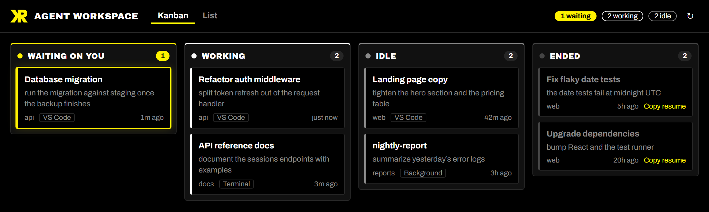
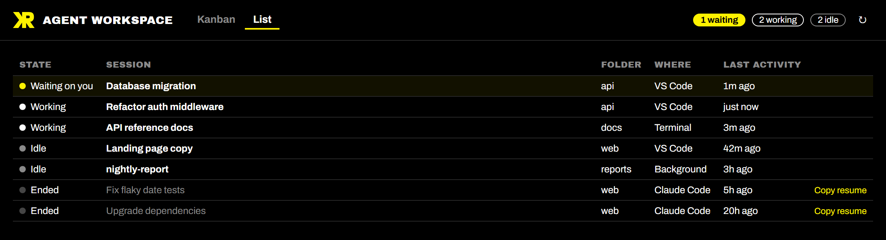
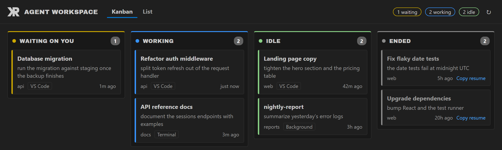

# Agent Workspace Dashboard

**By Keith Ratner** · [github.com/kratner](https://github.com/kratner)

See every Claude Code session you have running, as a Kanban board or a list, and spot the one that's waiting on you.

## Features

- **Kanban and List views.** Sessions are grouped by state: Waiting on you, Working, Idle and Ended. Switch views in the header; the dashboard remembers your choice for each workspace.
- **Know what needs you.** A session waiting for your reply or approval gets its own column, a highlighted card and a count in the status bar.
- **Live.** Cards move as sessions change state. You never need to refresh.
- **Every session, wherever it runs.** It shows Claude Code panels in VS Code, the CLI in a terminal and background agents, across all your project folders.
- **Click to open.** Clicking a card brings a session in this window to the front, or resumes an ended one. For a session running elsewhere, it tells you where.
- **Resume ended sessions.** **Copy resume** puts the `claude --resume` command for that session on your clipboard.
- **Two looks.** The KR brand (black and yellow) by default, or follow your VS Code color theme.
- **Read-only and local.** It reads files Claude Code already writes on your machine. It never starts, stops or changes a session, and it sends nothing over the network.

## Getting started

1. Have [Claude Code](https://claude.com/claude-code) installed, as the VS Code extension, the CLI, or both.
2. Open the dashboard:
   - click the robot icon in the status bar, or
   - run **Agent Workspace: Open Dashboard** from the Command Palette.
3. Start or continue a Claude Code session. Its card appears within a few seconds.

## Commands

| Command | What it does |
| --- | --- |
| **Agent Workspace: Open Dashboard** | Opens the dashboard in an editor tab, or brings it to the front |
| **Agent Workspace: Refresh Sessions** | Re-reads session files immediately |

## Settings

| Setting | Default | What it does |
| --- | --- | --- |
| `agentWorkspace.appearance` | `brand` | `brand` is the KR black-and-yellow look. `vscode` follows your color theme; use it with light themes. |
| `agentWorkspace.endedWithinHours` | `24` | How far back to show ended sessions. `0` hides them. |
| `agentWorkspace.showStatusBar` | `true` | Show the working and waiting counts in the status bar |

## How it works

Claude Code keeps a small status file for each running session (`~/.claude/sessions/`) and a transcript for every session (`~/.claude/projects/`). The dashboard watches those files and turns each session into a card:

- **Title:** the session's own title.
- **Last prompt.**
- **Folder.**
- **Where it runs:** VS Code, Terminal or Background.
- **Last activity:** how long ago.

If you've set `CLAUDE_CONFIG_DIR`, the dashboard reads that folder instead of `~/.claude`.

## Requirements

- VS Code 1.94 or newer.
- Claude Code on the same machine.
- Built for Windows and macOS. Tested on Windows so far.

## Known limitations

- **The status files aren't an official API.** Claude Code's session status files are internal and undocumented, so a Claude Code update could change them. The dashboard reads them defensively: a status it doesn't recognise shows as Idle.
- **"Waiting on you" depends on Claude Code.** That column only fills if Claude Code records a waiting state in its status files. This hasn't been confirmed yet.
- **Sessions in other windows or terminals.** The dashboard can't switch to another VS Code window or a terminal. It tells you where the session is running instead.
- **Claude Code only, for now.** Other agent systems such as Copilot or ChatGPT can be added as sources later; see [DEVELOPMENT.md](DEVELOPMENT.md).

## Installation

The extension isn't on the Visual Studio Marketplace yet. To build it and install it from source, see [DEVELOPMENT.md](DEVELOPMENT.md#install-from-source).

## Release notes

See [CHANGELOG.md](CHANGELOG.md).

## Author

Created by **Keith Ratner** ([github.com/kratner](https://github.com/kratner)). The icon, colors and type come from his KR brand. The bundled fonts, Archivo and Archivo Black, are under the SIL Open Font License (see `licenses/`).
