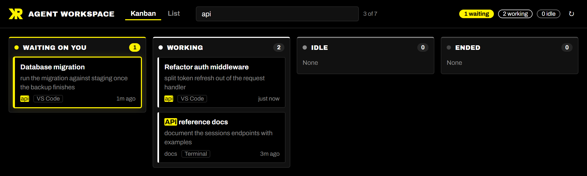
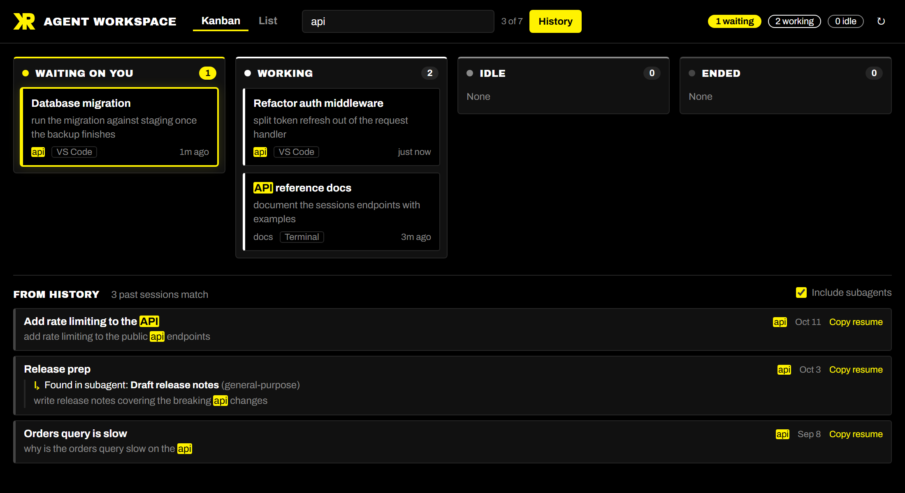

# Agent Workspace Dashboard

**By Keith Ratner** · [github.com/kratner](https://github.com/kratner)

See every Claude Code session you have running, as a Kanban board or a list, and spot the one that's waiting on you.

## Features

- **Kanban and List views.** Sessions are grouped by state: Waiting on you, Working, Idle and Ended. Switch views in the header; the dashboard remembers your choice for each workspace.
- **Know what needs you.** A session waiting for your reply or approval gets its own column, a highlighted card and a count in the status bar.
- **Search.** Filter either view as you type, by title, prompt, folder, where it runs or state. Matches are highlighted.
- **Search your whole history.** Switch on **History** to search every past Claude Code session on the machine, including what its subagents did, and resume any of them.
- **Live.** Cards move as sessions change state. You never need to refresh.
- **Every session, wherever it runs.** It shows Claude Code panels in VS Code, the CLI in a terminal and background agents, across all your project folders.
- **Click to open.** Clicking a card brings a session in this window to the front, or resumes an ended one. For a session running elsewhere, it tells you where.
- **Resume ended sessions.** **Copy resume** puts the `claude --resume` command for that session on your clipboard.
- **Two looks.** The KR brand (black and yellow) by default, or follow your VS Code color theme.
- **Read-only and local.** It reads files Claude Code already writes on your machine. It never starts, stops or changes a session, and it sends nothing over the network. The history index is stored locally, in the extension's own storage.

## Getting started

1. Have [Claude Code](https://claude.com/claude-code) installed, as the VS Code extension, the CLI, or both.
2. Open the dashboard:
   - click the robot icon in the status bar, or
   - run **Agent Workspace: Open Dashboard** from the Command Palette.
3. Start or continue a Claude Code session. Its card appears within a few seconds.

## Searching

Type in the search box in the header, or press `/` or Ctrl+F (⌘F on macOS) to jump to it. Both views filter as you type.

- **What it searches:** each session's title, last prompt, folder path, where it runs (VS Code, Terminal, Background) and state (Waiting on you, Working, Idle, Ended). So `waiting` or `terminal` works as a query too.
- **Several words:** a session must contain all of them. `api waiting` finds the waiting session in the `api` folder.
- **Matches are highlighted.** In the List view, which has no prompt column, a prompt that matched appears under the title while you search.
- **Your search stays** when you switch tabs and come back. Press Esc in the box to clear it.
- **Scope:** search covers the sessions on the dashboard, meaning running ones plus those ended within `agentWorkspace.endedWithinHours`. To go further back, switch on History.

### Searching history

Click **History** next to the search box. While it's on, a **From history** section lists matching past sessions below the current ones, newest first.

- **What it searches:** every Claude Code session on this machine. For each one it reads the title, the folder and **every prompt you typed**, not just the last one. It doesn't search Claude's replies or tool output.
- **Results:** each row shows the session's title, folder, date and the line that matched. Click a row to resume the session, or use **Copy resume** to get the terminal command.
- **Subagents:** work done inside a subagent counts too. A match there appears under its parent session, as **↳ Found in subagent: *task description***, with the matching line. If several subagents match, the first one is shown with **+N more subagents** to expand. Untick **Include subagents** to search only top-level sessions.
- **Lots of matches:** up to 150 results all show. Above that you see the 25 most recent first, with a **Show all** button; the rest then load as you scroll. The `agentWorkspace.historyResultThreshold` setting moves that cut-off anywhere from 100 to 200.
- **Indexing:**
  - The first time you search history, the extension builds an index of your transcripts in the background, with a progress line. On a 1 GB history it took under 2 seconds.
  - After that it only reads what's new, and the index is cached between restarts.
  - It's stored only on this machine, in the extension's own storage.

## Commands

| Command | What it does |
| --- | --- |
| **Agent Workspace: Open Dashboard** | Opens the dashboard in an editor tab, or brings it to the front |
| **Agent Workspace: Refresh Sessions** | Re-reads session files immediately |

## Settings

| Setting | Default | What it does |
| --- | --- | --- |
| `agentWorkspace.appearance` | `brand` | `brand` is the KR black-and-yellow look. `vscode` follows your color theme; use it with light themes. |
| `agentWorkspace.endedWithinHours` | `24` | How far back to show ended sessions. `0` hides them. |
| `agentWorkspace.showStatusBar` | `true` | Show the working and waiting counts in the status bar |
| `agentWorkspace.historyResultThreshold` | `150` | History search: above this many matches (100–200), show the 25 most recent first, with a button to show all |

## How it works

Claude Code keeps a small status file for each running session (`~/.claude/sessions/`) and a transcript for every session (`~/.claude/projects/`). The dashboard watches those files and turns each session into a card:

- **Title:** the session's own title.
- **Last prompt.**
- **Folder.**
- **Where it runs:** VS Code, Terminal or Background.
- **Last activity:** how long ago.

If you've set `CLAUDE_CONFIG_DIR`, the dashboard reads that folder instead of `~/.claude`.

## Requirements

- VS Code 1.94 or newer.
- Claude Code on the same machine.
- Built for Windows and macOS. Tested on Windows so far.

## Known limitations

- **The status files aren't an official API.** Claude Code's session status files are internal and undocumented, so a Claude Code update could change them. The dashboard reads them defensively: a status it doesn't recognise shows as Idle.
- **Sessions in other windows or terminals.** The dashboard can't switch to another VS Code window or a terminal. It tells you where the session is running instead.
- **Claude Code only, for now.** Other agent systems such as Copilot or ChatGPT can be added as sources later; see [DEVELOPMENT.md](DEVELOPMENT.md).

## Installation

The extension isn't on the Visual Studio Marketplace yet. To build it and install it from source, see [DEVELOPMENT.md](DEVELOPMENT.md#install-from-source).

## Release notes and roadmap

- **What changed:** see [CHANGELOG.md](CHANGELOG.md).
- **What's next:** see [ROADMAP.md](ROADMAP.md). The next milestone is searching your full session history.

## Author

Created by **Keith Ratner** ([github.com/kratner](https://github.com/kratner)). The icon, colors and type come from his KR brand.

## License

[MIT](LICENSE) © 2026 Keith Ratner. The bundled fonts, Archivo and Archivo Black, are under the SIL Open Font License; see `licenses/`.
