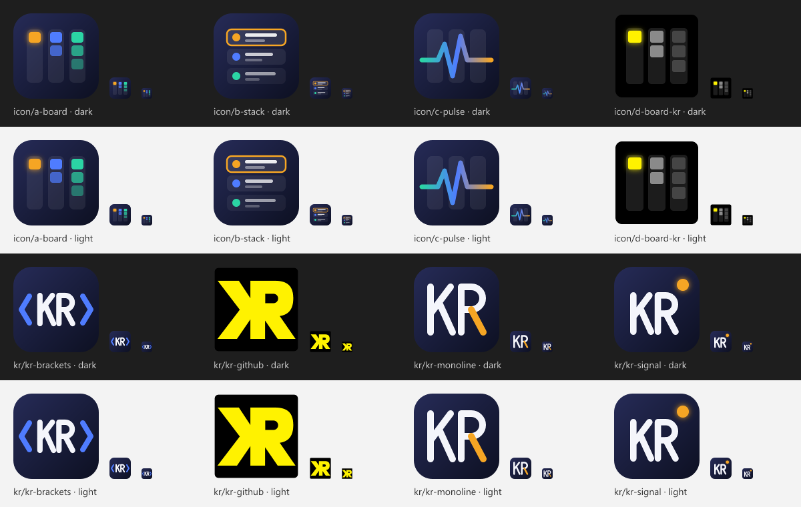

# Branding

Working files for the Agent Workspace Dashboard icon and the Keith Ratner "KR" mark.



## Idea

The brand colors are the dashboard's own state colors: amber means a session is waiting on you, blue means working, green means idle. They sit on a deep ink-blue tile. So the icon, the KR mark and the product all use one color system, and amber is the accent ("this needs you").

## Palette

| Role | Hex | Used for |
| --- | --- | --- |
| Ink (top) | `#262B57` | Tile gradient start |
| Ink (bottom) | `#0D1022` | Tile gradient end |
| Paper | `#F4F5FB` | Letterforms on ink |
| Signal amber | `#F5A524` | Accent; "waiting on you" |
| Working blue | `#4F7CFF` | Secondary accent; "working" |
| Idle green | `#2BD4A4` | Tertiary; "idle" |

The tile is a 128 × 128 rounded square, corner radius 28, with the gradient running top-left to bottom-right. Strokes in the KR marks are round-capped and of even weight.

## Concepts

| File | Concept |
| --- | --- |
| `icon/a-board.svg` | Three Kanban columns; the single glowing amber card is the session waiting on you. |
| `icon/b-stack.svg` | Three session rows with status dots, like the List view; the waiting row is outlined. |
| `icon/c-pulse.svg` | Board columns with a live heartbeat line crossing them. |
| `icon/d-board-kr.svg` | **Shipping icon.** Concept A in the KR colors: the waiting card is the only yellow (`#FFF200`); working and idle cards are neutral grays on black. `npm run brand` renders it to `media/icon.png`. |
| `kr/kr-github.svg` | Vector reproduction of Keith's GitHub avatar (see below). |
| `kr/kr-monoline.svg` | K and R in one even stroke; R's leg in amber. |
| `kr/kr-brackets.svg` | The same KR between blue code chevrons. |
| `kr/kr-signal.svg` | The same KR with an amber status dot. |

## The GitHub KR mark

`kr/kr-github.svg` reproduces the avatar on github.com/kratner as vectors, so it can be used at any size. The original raster is kept at `kr/reference/github-avatar.png`. The SVG uses the avatar's own 460 px grid.

| Element | Value |
| --- | --- |
| Yellow | `#FFF200` |
| Background | `#000000`, rounded square, radius 20 on a 448 px tile with a 6 px margin |
| K | A chevron, point at mid-height, sharing its stem with the R |
| R | Bowl with a D-shaped hole, straight diagonal leg |

The vector matches the avatar on 98.9% of its yellow pixels. The rest is about one pixel of edge softening in the original. To re-check after editing:

```sh
npm run brand:compare -- branding/kr/reference/github-avatar.png branding/kr/kr-github.svg branding/preview/kr-github-diff.png
```

In the diff image, red is only in the avatar and cyan is only in the SVG.

## Rendering

```sh
npm run brand
```

This renders every SVG in `icon/` and `kr/` to `preview/<group>-<name>-128.png` and `-512.png`, and draws `preview/sheet.png`, which shows each mark at 128, 32 and 16 px on dark and light backgrounds. Edit an SVG, re-run the command and check the sheet. Small sizes are where icons fail.

The extension's Marketplace icon is a 128 × 128 PNG referenced from `package.json` (`"icon"`). When one concept is chosen, it gets rendered there. Nothing in `branding/` ships in the `.vsix`.
